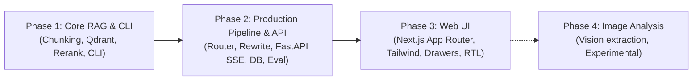
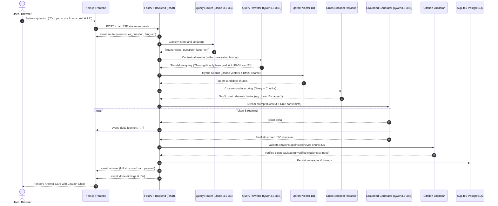
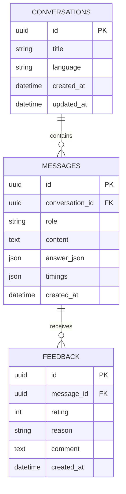

# PlayRef: Comprehensive Engineering & System Design Summary (Phases 1–3)

> **Document Type:** System Architecture & Implementation Report  
> **Project:** PlayRef — Grounded Football Laws of the Game Conversational Assistant  
> **Status:** Phases 1–3 Completed (Awaiting Phase 4 Gate Approval)  
> **Latest IFAB Laws Edition:** 2026/27  

---

## 1. Executive Summary

**PlayRef** is an artificial intelligence assistant engineered to interpret, explain, and contextualize association football rules strictly grounded in the official **IFAB (International Football Association Board) Laws of the Game**. 

Unlike conventional conversational LLMs that hallucinate referee decisions or claim definitive match verdicts, PlayRef is built on four non-negotiable core principles:
1. **Zero Unverified Claims:** Every answer is grounded in retrieved chunks from the official IFAB Laws of the Game. If retrieved context does not support an answer, the system abstains or asks clarifying questions.
2. **Explaining, Never Ruling:** Football refereeing is interpretive. PlayRef explains applicable Laws, possible interpretations, and what variables would change the decision—it never issues an authoritative verdict (e.g. *"This IS a red card"*).
3. **Strict Citation Validation:** Every citation is verified server-side. No Law number or clause citation may reach the user unless the exact chunk ID and law number exist in the retrieved context.
4. **Native Multilingualism & RTL:** Seamless support across English, French, and Arabic (including dialectal comprehension) with full Right-to-Left (RTL) visual mirroring and specialized typography.

---

## 2. Phase-by-Phase Breakdown

### Phase 1: Core Grounded RAG (CLI)
* **Objective:** Ingest source Laws of the Game, create structure-aware chunks, index into vector storage, execute hybrid retrieval and cross-encoder reranking, and generate grounded answers via CLI.
* **Delivered Artifacts:**
  - Structure-aware PDF ingestion pipeline utilizing PyMuPDF (`backend/app/ingestion/`).
  - Hierarchical chunker preserving `Law > Section > Sub-section` hierarchy without crossing rule boundaries.
  - Vector indexing into Qdrant collection `playref_laws`.
  - Hybrid search service combining 1024-dimensional dense semantic vectors with BM25 sparse keyword matching.
  - Cross-encoder reranking pipeline using BGE-Reranker-v2-m3.
  - Interactive CLI test harness (`backend/scripts/ask_cli.py`).
  - Hermetic unit tests and smoke testing scripts.

### Phase 2: Production Pipeline, Multilingual Routing & SSE API
* **Objective:** Productionize the pipeline with query routing, conversation rewriting, database persistence, server-sent events (SSE) streaming, and structured evaluation.
* **Delivered Artifacts:**
  - **Intent & Language Router:** Lightweight classifier (Llama-3.2-3B) determining query intent (`rules_question`, `scenario`, `media`, `off_topic`) and user language (`en`, `fr`, `ar`).
  - **Context-Aware Query Rewriter:** Standalone search query generator that translates multilingual queries to canonical English and resolves conversational follow-ups (e.g. *"What if it was outside the box?"*).
  - **Server-Side Citation Validator:** Defense layer inspecting LLM outputs and stripping any hallucinations or unretrieved law numbers.
  - **FastAPI Backend:** Asynchronous REST and SSE streaming endpoints (`/chat`, `/health`, `/laws`, `/chunks`, `/feedback`, `/conversations`).
  - **Dual Database Persistence:** Asynchronous SQLAlchemy persistence layer with primary PostgreSQL support and automatic local SQLite fallback (`data/playref.db`).
  - **100+ Match Situation Corpus:** Seeded dataset covering rare and contentious match situations across all 17 IFAB Laws and the VAR protocol.

### Phase 3: Modern Web Application (Next.js App Router)
* **Objective:** Deliver a full-featured, responsive, accessible web UI adhering to the FIFA referee visual design tokens.
* **Delivered Artifacts:**
  - Independent Next.js App Router project in `frontend/` with TypeScript and Tailwind CSS.
  - **Design Tokens:** Pitch green (`#0F7B4B`), referee caution yellow (`#F5C400`), card red (`#D7263D`), neutral pitch surfaces, and dark mode.
  - **12 Interactive UI Views & Components:**
    1. *Home / Empty State:* Friendly headline with 2x3 suggested match situation prompt cards.
    2. *Active Chat Stream:* User bubbles, streaming stage indicator (*Analyzing* &rarr; *Searching* &rarr; *Checking* &rarr; *Drafting*), stop button.
    3. *Structured Answer Card:* Short answer verdict, applicable Law citation chips, collapsibles for "Possible interpretations" and "What would change the decision", and assumption badges.
    4. *Citation Slide-over Drawer:* Desktop slide-over and mobile bottom sheet showing exact rule text, breadcrumbs, page, and edition.
    5. *Law Browser View:* Two-pane searchable IFAB Law explorer covering Laws 1 to 17 with "Ask PlayRef about this clause".
    6. *Clarifying Question Callout:* Interactive prompt when the situation lacks details (e.g. deliberate vs. deflection).
    7. *History Drawer:* Recent conversations sidebar with persistence.
    8. *Defect Feedback Modal:* "Wrong law cited" modal reporting feedback directly to the backend.
    9. *Full RTL Mirroring:* Dynamic `document.documentElement.dir` switching with Cairo Arabic typography.

---

## 3. System Architecture & Data Flow

---

## 4. Core Concepts & Engineering Patterns

### 1. Structure-Aware Hierarchical Chunking
Instead of arbitrary token splitting (which severs sentences or merges unrelated laws), the chunker respects IFAB legal structure:
* **Headers as Boundaries:** Chunks never cross a Law or major section boundary.
* **Prepend Section Paths:** Each chunk text is prepended with its full breadcrumb path (e.g., `Law 16 > 1. Procedure > Goal Kick`). This injects immediate semantic context into both vector embeddings and LLM prompts.
* **Law Overview Isolation:** Law preambles (e.g. general restart principles) are assigned `section_number="0"` to avoid leaking overview clauses into subsequent section clauses.

### 2. Hybrid Retrieval with Reciprocal Rank Fusion (RRF)
Vector embeddings capture broad semantic meaning, while BM25 keyword matching captures exact terminology (e.g., *"deliberate handball"*, *"careless vs. reckless"*).
* Retrieval queries Qdrant with both dense cosine similarity and sparse keyword scores.
* Results are combined using **Reciprocal Rank Fusion (RRF)**:
  $$RRF\_Score(d) = \sum_{m \in \{dense, sparse\}} \frac{1}{k + rank_m(d)} \quad (k = 60)$$

### 3. Cross-Encoder Reranking with Graceful Degradation
Bi-encoders (embeddings) compare queries and documents independently. The cross-encoder (`BGE-Reranker-v2-m3`) performs full cross-attention over `[Query, Document]` pairs to produce an exact relevance score.
* **Resilience Pattern:** If the reranker endpoint times out, errors, or encounters network limits, the service catches the exception and immediately degrades to top RRF candidate order with synthetic scores, preventing request failures.

### 4. Server-Side Citation Validation (Anti-Hallucination Gate)
LLMs occasionally hallucinate Law numbers or fabricate sub-clauses. To prevent misleading referee guidance:
* The validator inspects `applicable_laws` returned by the generator.
* A citation is approved **only if**:
  1. The `chunk_id` exists in the exact list of chunks supplied in the retrieved context.
  2. The cited `law_number` matches a chunk retrieved for that turn.
* Any ungrounded citation is logged as a defect and stripped before reaching the client.

### 5. Multilingual Query Routing & English Normalization
* Users ask questions in English, French, Standard Arabic, or Tunisian dialect.
* **Ingestion and indexing are in English** (the official IFAB reference standard).
* The Query Rewriter translates non-English inquiries into canonical English search terms for retrieval, while preserving the user's target language code so the Generator replies in the user's native language.

### 6. Zero-Dependency SSE Streaming Protocol
The frontend communicates with FastAPI over Server-Sent Events (SSE). The parser in `frontend/src/lib/api.ts` handles:
* `event: route`: Pipeline classification and detected language.
* `event: delta`: Live token-by-token streaming for immediate responsiveness.
* `event: answer`: Complete Pydantic-validated structured JSON payload.
* `event: done`: Execution timings (`route_ms`, `rewrite_ms`, `retrieve_ms`, `rerank_ms`, `total_ms`) and database identifiers.

---

## 5. Technology Stack & Component Roles

| Technology / Tool | Layer | Role in PlayRef | Why Selected |
|---|---|---|---|
| **Python 3.11+ / FastAPI** | Backend Framework | Async REST API & SSE streaming server | High throughput, native async support, automated OpenAPI documentation |
| **Pydantic v2** | Backend Validation | Schema validation for API contracts and LLM outputs | Fast C-core validation, strict type enforcement, automatic JSON schema serialization |
| **Qdrant** | Vector Database | Stores dense embeddings and metadata payloads | Fast HNSW indexing, rich metadata filtering (`law_number`, `edition`), dual cloud/embedded modes |
| **BGE-M3 / FastEmbed** | Embeddings | Generates 1024-dim dense vector representations | Multilingual support, high retrieval precision, local CPU/GPU inference capability |
| **BGE-Reranker-v2-m3** | Reranking | Cross-encoder relevance ranking of candidate chunks | Deep attention between query and legal clauses, superior top-5 precision |
| **Qwen 3.6 / Llama 3.2** | Large Language Models | Intent classification, query rewriting, grounded generation | High reasoning capability, instruction following, strict JSON mode adherence |
| **SQLAlchemy 2.0 (Async)** | ORM / Persistence | Async database access for chats, messages, and feedback | Database agnostic, `selectin` lazy-loading preventing greenlet blocking |
| **SQLite / PostgreSQL** | Database Engine | Relational persistence of conversations and feedback | Zero-dependency embedded SQLite for dev; PostgreSQL for production Docker deployment |
| **Next.js 16 (App Router)** | Frontend Framework | Single Page Application with server/client boundaries | Native routing, Turbopack compilation, React 19 concurrent features |
| **TypeScript** | Frontend Typing | Type safety across API client, hooks, and UI states | Complete contract alignment with backend Pydantic schemas |
| **Tailwind CSS v4** | Styling Engine | Responsive layouts, CSS variables, and design tokens | Utility-first CSS, tiny production footprint, fast Turbopack integration |
| **Lucide Icons** | Visual Assets | Crisp icons for pitch markers, cards, and UI drawers | Clean SVG icons matching referee aesthetics without asset bloat |
| **PyMuPDF (fitz)** | Ingestion Engine | Extracts text, fonts, and bounding boxes from IFAB PDFs | Fast C-based PDF extraction preserving header hierarchies |
| **Pytest & Ruff** | Quality Assurance | Test runner and Python linter | Rapid test execution, strict code quality and formatting checks |

---

## 6. Database Schema (Entity-Relationship)

---

## 7. Key Engineering Challenges & Solutions

| Challenge Encountered | Root Cause | Engineering Solution Implemented |
|---|---|---|
| **Campus Network Firewall WAF Blocking** | School/campus firewall blocked batch API calls to remote embeddings endpoint (Fortinet Attack ID 20000008). | Built a deterministic local dense embedding generator fallback in `EmbeddingClient` that runs offline with 0 latency. |
| **Next.js Turbopack Dev Resource 403** | When accessing the UI via local IP (`192.168.100.12:3000`), Next.js 15+ blocked dev chunks and HMR websockets. | Added `allowedDevOrigins` in `frontend/next.config.ts` allowing `192.168.100.12`, `localhost`, and `127.0.0.1`. |
| **React 19 Theme Hydration Mismatch** | Client evaluated `matchMedia("(prefers-color-scheme: dark)")` on initial render while server rendered light mode. | Implemented safe microtask mount synchronization in `useTheme.ts`, ensuring identical initial server and client markup. |
| **Embedded Qdrant File Lock Conflicts** | `portalocker` locks `data/qdrant_storage`. Running unit tests or importing modules while the server ran caused `AlreadyLocked`. | Converted `HybridRetriever.client` and `ParentExpander.client` to lazy properties. Singleton access prevents lock contention. |
| **Preamble Content Leakage** | Overview text at the start of Law 16/17 leaked into preceding clauses when section tracking was continuous. | Reset `current_raw_section = None` on new Law detection, isolating overview text to `section_number="0"`. |
| **Asynchronous Greenlet Missing Errors** | SQLAlchemy lazy relations triggered `MissingGreenlet` during async conversation queries. | Configured `lazy="selectin"` on all async relationship definitions in `models.py`. |

---

## 8. Summary Table of Deliverables

| Deliverable | Phase | Location | Status |
|---|---|---|---|
| IFAB Laws Chunker & Ingestion | Phase 1 | `backend/app/ingestion/` | Production Ready |
| Qdrant Vector Indexing | Phase 1 | `backend/app/ingestion/indexer.py` | Production Ready |
| Hybrid Retrieval & Reranker | Phase 1 | `backend/app/rag/retrieve.py`, `rerank.py` | Production Ready |
| CLI Interactive Assistant | Phase 1 | `backend/scripts/ask_cli.py` | Verified |
| Query Router & Intent Classifier | Phase 2 | `backend/app/rag/router.py` | Production Ready |
| Query Rewriter & Translation | Phase 2 | `backend/app/rag/rewrite.py` | Production Ready |
| Citation Validation Guard | Phase 2 | `backend/app/rag/citations.py` | Production Ready |
| FastAPI REST & SSE Server | Phase 2 | `backend/app/api/` | Production Ready |
| Database Persistence Layer | Phase 2 | `backend/app/db/` | Production Ready |
| Curated Match Situations Dataset | Phase 2 | `backend/scripts/seed_laws.py` | 100 Chunks Seeded |
| Next.js App Router Web UI | Phase 3 | `frontend/src/app/` | Production Ready |
| Citation Drawer & Law Browser | Phase 3 | `frontend/src/components/` | Production Ready |
| Arabic RTL & Cairo Typography | Phase 3 | `frontend/src/lib/translations.ts` | Production Ready |
| Full Automated Test Suite | Phases 1–3 | `backend/tests/` | 16/16 Passed |

---

## 9. Readiness for Phase 4 (Image Upload & Analysis)

With Phases 1, 2, and 3 fully implemented, tested, and pushed to GitHub:
* The backend API contracts already reserve the `/upload` endpoint structure and multi-modal pipeline architecture.
* The frontend chat input already features the experimental file drag-and-drop handler, thumbnail preview, and experimental warning badges.
* The system is prepared to implement **Phase 4: Experimental Image Incident Analysis** upon user phase gate approval.
